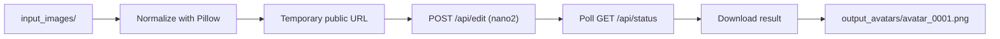

# Img2Img Batch Avatar Generator

Turn a folder of ordinary photos into stylized, pop-art cartoon avatars in one command. This pipeline is **powered by [Nano Banana](https://nanobnana.com)'s image generation API**. It sends each photo to the `nano2` image-editing model with a curated style prompt and saves the results automatically, recreating the "Lensa AI" magic-avatar effect with open-source code.

> 📖 **[Read the Full Tutorial →](https://christopherlazok.com/blog/recreating-lensa-ai-stable-diffusion)**

---

## Features

- **Powered by Nano Banana**: uses the [Image-to-Image API](https://nanobnana.com/docs/api/image-to-image) with the `nano2` model (`nano` and `nano2pro` also supported).
- **Batch processing**: drop any number of photos into `input_images/` and run once.
- **Async task polling**: submits each job to `POST /api/edit`, then polls `GET /api/status` until the image is ready.
- **Curated style prompt**: *"highly detailed flat vector art illustration, pop art style, professional cartoon illustration, masterpiece, clean lines, solid background."*
- **Sequential output naming**: `avatar_0001.png`, `avatar_0002.png`, and so on. Existing results are never overwritten.
- **Robust error handling**: skips non-image and corrupt files, retries rate limits (HTTP 429) and server errors with exponential backoff, and stops early on bad API keys or insufficient credits.
- **Automatic preprocessing**: fixes EXIF rotation, converts to RGB, and downsizes large photos.

## How It Works



> **Why a temporary upload?** The Nano Banana API only accepts **publicly accessible image URLs**. By default, each local photo is uploaded to [Litterbox](https://litterbox.catbox.moe), an anonymous host that deletes files automatically after 1 hour. If your images are already hosted (for example, in an S3 bucket or on a CDN), set `PUBLIC_IMAGE_BASE_URL` and the upload step is skipped. Your API key is only ever sent to `nanobnana.com`.

## Prerequisites

- **Python 3.9+**
- A **Nano Banana API key** with available credits: [nanobnana.com](https://nanobnana.com)

## Installation

```bash
# 1. Clone the repository
git clone https://github.com/tidypy/img2img-batch-avitar-generator.git
cd img2img-batch-avitar-generator

# 2. Create and activate a virtual environment
python -m venv venv
# macOS / Linux
source venv/bin/activate
# Windows (PowerShell)
venv\Scripts\Activate.ps1

# 3. Install dependencies
pip install -r requirements.txt

# 4. Configure your API key
cp .env.example .env        # Windows: copy .env.example .env
# then edit .env and set NANO_BANANA_API_KEY=...
```

## Usage

1. Place your source photos (`.jpg`, `.jpeg`, `.png`, `.webp`, `.bmp`, `.tiff`) in `input_images/`.
2. Run the script:

   ```bash
   python batch_ai_avatars.py
   ```

3. Find your avatars in `output_avatars/`.

### Common options

| Flag | Default | Description |
|------|---------|-------------|
| `-i, --input` | `input_images` | Source image folder |
| `-o, --output` | `output_avatars` | Destination folder |
| `--model` | `nano2` | `nano`, `nano2`, or `nano2pro` |
| `--prompt` | pop-art style prompt | Styling prompt |
| `--aspect-ratio` | `1:1` | Output aspect ratio |
| `--resolution` | `1K` | `1K`, `2K`, or `4K` |
| `--public-base-url` | *(none)* | Base URL of already-hosted inputs (skips upload) |
| `--poll-interval` | `3` | Seconds between status checks |
| `--poll-timeout` | `300` | Max seconds to wait per image |
| `--delay` | `1.0` | Seconds to wait between images |
| `-v, --verbose` | off | Debug logging (shows task IDs and URLs) |

Example: generate higher-resolution avatars with the Pro model:

```bash
python batch_ai_avatars.py --model nano2pro --resolution 2K
```

Run `python batch_ai_avatars.py --help` for the complete list.

## Before/After Examples

<!-- Replace the placeholders below with your own results. -->

| Before | After |
|--------|-------|
|  |  |
|  |  |

*Examples coming soon.*

## Read the Full Tutorial

Want to understand how this works under the hood, and how it recreates the Lensa AI avatar effect?

👉 **[Recreating Lensa AI with Stable Diffusion](https://christopherlazok.com/blog/recreating-lensa-ai-stable-diffusion)**

## Privacy & Security

- `.env`, `input_images/`, and `output_avatars/` are git-ignored, so your API key and personal photos are never committed.
- Photos are sent to a third-party temporary host and to Nano Banana for processing. Avoid sensitive images, or use `PUBLIC_IMAGE_BASE_URL` with storage you control.
- Never put a real API key in `.env.example` or any committed file.

## Contributing

Issues and pull requests are welcome! Please open an issue to discuss significant changes first.
