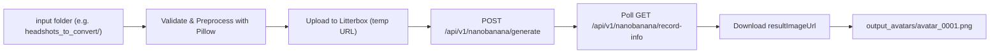

# Img2Img Batch Avatar Generator

Turn a folder of ordinary photos into stylized, pop-art cartoon avatars in one command. This pipeline is **powered by the [NanoBanana API](https://docs.nanobananaapi.ai)** (`nanobananaapi.ai`). It sends each photo to the image-to-image endpoint with a curated style prompt, polls task status asynchronously, and saves the results automatically.

> 📖 **[Read the Full Tutorial →](https://christopherlazok.com/blog/recreating-lensa-ai-stable-diffusion)**

---

## Features

- **Powered by NanoBanana API**: uses the official image generation endpoints:
  - Task Creation: `POST https://api.nanobananaapi.ai/api/v1/nanobanana/generate`
  - Task Status Query: `GET https://api.nanobananaapi.ai/api/v1/nanobanana/record-info`
- **Batch Processing**: drop any number of photos into an input folder and process them sequentially with automatic progress reporting.
- **Image-to-Image Mode**: passes `"type": "IMAGETOIAMGE"` along with public reference image URLs in `"imageUrls": [...]`.
- **Litterbox Upload Bridge**: automatically resizes and uploads local headshots to [Litterbox](https://litterbox.catbox.moe) (temporary 1-hour hosting) so the API receives reachable public URLs.
- **Curated Style Prompt**: *"highly detailed flat vector art illustration, pop art style, professional cartoon illustration, masterpiece, clean lines, solid background"*
- **Sequential Output Naming**: `avatar_0001.png`, `avatar_0002.png`, and so on. Existing outputs are detected to prevent overwriting.
- **Robust Error Handling & Backoff**: skips non-image files, handles rate limiting with exponential backoff, and halts early on authentication errors.

## How It Works



> **Why a temporary upload bridge?** The NanoBanana API requires image URLs in `imageUrls` to be publicly accessible. By default, local headshots are safely converted to RGB, normalized, and uploaded to Litterbox (auto-deleted after 1 hour). If your images are already hosted (e.g., S3 or CDN), you can specify `--public-base-url` to skip temporary uploads. Your API key is only sent directly to `api.nanobananaapi.ai`.

## Prerequisites

- **Python 3.9+**
- A **NanoBanana API key**: [nanobananaapi.ai](https://nanobananaapi.ai)

## Installation

```bash
# 1. Clone the repository
git clone https://github.com/tidypy/img2img-batch-avitar-generator.git
cd img2img-batch-avitar-generator

# 2. Create and activate a virtual environment
python -m venv venv
# macOS / Linux
source venv/bin/activate
# Windows (PowerShell)
venv\Scripts\Activate.ps1

# 3. Install dependencies
pip install -r requirements.txt

# 4. Configure your API key
cp .env.example .env        # Windows: copy .env.example .env
# then edit .env and set NANO_BANANA_API_KEY=your_api_key_here
```

## Usage

Place your source photos (`.jpg`, `.jpeg`, `.png`, `.webp`, `.bmp`, `.tiff`) in your input directory, then run:

```bash
# Process a folder of headshots
python batch_ai_avatars.py -i "headshots_to_convert"
```

For verbose execution logs:
```bash
python batch_ai_avatars.py -i "headshots_to_convert" -v
```

To run a single-image verification test before the full batch:
```bash
python batch_ai_avatars.py -i "headshots_to_convert" --limit 1 -v
```

Generated avatars will be saved sequentially into `output_avatars/` (`avatar_0001.png`, `avatar_0002.png`, etc.).

### Common Options

| Flag | Default | Description |
|------|---------|-------------|
| `-i, --input` | `input_images` | Source image folder |
| `-o, --output` | `output_avatars` | Destination folder |
| `--prompt` | vector pop-art prompt | Styling prompt |
| `--image-size` | `1:1` | Aspect ratio (`1:1`, `9:16`, `16:9`, `3:4`, `4:3`, `3:2`, `2:3`, `5:4`, `4:5`, `21:9`) |
| `--num-images` | `1` | Number of images to generate per input (`1`–`4`) |
| `--limit` | *(none)* | Limit processing to the first N images |
| `--public-base-url` | *(none)* | Base URL for already-hosted images (skips Litterbox upload) |
| `--poll-interval` | `3.0` | Seconds between task status polling requests |
| `--poll-timeout` | `300.0` | Maximum seconds to poll before timing out |
| `--delay` | `1.0` | Throttling pause (seconds) between tasks |
| `-v, --verbose` | off | Enable detailed debug logging |

## Before/After Examples

<!-- Replace the placeholders below with your own results. -->

| Before | After |
|--------|-------|
|  |  |
|  |  |

*Examples coming soon.*

## Read the Full Tutorial

Want to understand how this works under the hood, and how it recreates the Lensa AI avatar effect?

👉 **[Recreating Lensa AI with Stable Diffusion](https://christopherlazok.com/blog/recreating-lensa-ai-stable-diffusion)**

## Privacy & Security

- `.env`, input directories, and `output_avatars/` are strictly ignored by Git to keep your API key and private headshots safe.
- Photos uploaded via the Litterbox bridge are temporary and expire automatically.
- Never commit active API keys to version control.
